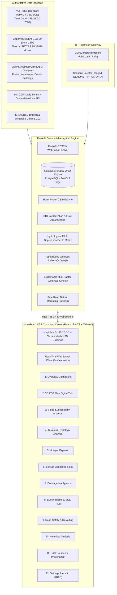

# WAVEGUARD KGF
## 3D Urban Flood Intelligence and Situational Awareness Platform
**Study Area:** Kolar Gold Fields (KGF) Taluk, Karnataka, India  
**Target Coordinate Reference Systems:** EPSG:32644 (WGS 84 / UTM zone 44N) & EPSG:4326 (WGS 84)

---

## 1. Executive Summary

**WaveGuard KGF** is an interactive, 3D geographical intelligence and urban flood situational awareness platform specifically engineered for Kolar Gold Fields (KGF), Karnataka.

Rather than presenting a generic dashboard with fabricated sensors, WaveGuard KGF integrates genuine geographical datasets, implements automated scientific terrain analysis (Horn slope gradients, multi-directional hillshade, D8 flow accumulation, depression analysis, Topographic Wetness Index), provides a configurable multi-factor flood susceptibility model, monitors IoT water-level sensor telemetry (with explicit *DEMONSTRATION DATA* labeling), performs differential drainage restriction diagnosis, and calculates safe road detours around verified flooded road segments.

---

## 2. Platform Architecture & Technology Stack



---

## 3. The 12 Platform Modules

1. **Overview Dashboard**: Executive situational awareness summary, active warning status, real-time weather metrics, live mini-map, priority vulnerability feed, and IoT station fleet quick-glance.
2. **3D KGF Map Digital Twin**: High-performance MapLibre GL JS 2D/3D map with perspective tilt, search bar jumping to KGF localities (Robertsonpet, Andersonpet, Champion Reefs, etc.), clickable scientific terrain probe, and 16 toggleable layers with legends.
3. **Flood Susceptibility Analysis**: Explainable Multi-Criteria Evaluation (MCE) weighted overlay model ($S = \sum w_i f_i(x)$) with live interactive weight sliders, normalization methods, class distribution breakdown (Low, Moderate, High, Very High), and CSV export.
4. **Terrain and Hydrology Analysis**: Elevation distribution (754.4m - 913.9m AMSL), Horn's slope in degrees, multi-directional hillshade, D8 flow accumulation, depression depth, and Topographic Wetness Index ($TWI = \ln(a / \tan \beta)$) with documented limitations.
5. **Hotspot Explorer**: Searchable and filterable candidate inundation hotspots (Andersonpet South Culvert, Robertsonpet Market Swarna Nallah, Champion Reefs Railway Underpass, Oorgaum Tailings Basin, etc.) with coordinates, elevation, slope, and field verification updater.
6. **Sensor Monitoring Fleet**: Real-time IoT station fleet monitoring (water depth, rainfall, battery MPPT health, RSSI signal), 24h hydrograph curves, warning/critical thresholds, and scenario simulation injection (`convective_storm`, `drainage_subsidence`, `normal_baseflow`). Explicitly tagged **DEMONSTRATION DATA**.
7. **Drainage Intelligence**: Multi-node differential hydraulic analysis comparing upstream vs downstream heads to detect potential bottlenecks, restrictions, or channel capacity overtopping.
8. **Live Incidents & SOS Triage**: Citizen incident submission portal with GPS geolocation, description, and photo support. Reports are logged as *unverified* with explicit instructions for life-threatening emergencies to call 112 directly. Authority verification actions available for admin users.
9. **Road Safety & Safe Detour Routing**: Dynamic route planning between KGF landmarks, calculating safe detours that bypass submerged underpasses and flooded road segments.
10. **Historical Analysis**: Historical IMD 0.25° gridded daily rainfall series and verified historical flood occurrences archive (2020, 2022, 2023).
11. **Data Sources & Provenance Registry**: Comprehensive metadata registry for Copernicus GLO-30, Karnataka Taluk boundary, OpenStreetMap, IMD Rainfall, and NRSC Bhuvan, detailing CRS, spatial resolution, licensing, and limitations, plus a manual file import modal.
12. **Settings & Administration**: Role-Based Access Control (RBAC) switcher (Chief Disaster Admin, Drainage Engineer, Field Surveyor, Public Resident), sensor registration form, threshold calibration, and platform audit log.

---

## 4. Scientific Foundations & Data Integrity Principles

- **Copernicus DEM GLO-30 DSM Notice:** The Copernicus DEM is a Digital Surface Model (DSM) reflecting tree canopy and structures, not a bare-earth terrain model. It is utilized for regional screening, not sub-meter underpass depths.
- **Administrative vs Hydrological Boundaries:** The supplied KGF polygon is the administrative taluk boundary. Catchments extend beyond this boundary; an upstream analysis buffer is provided.
- **Susceptibility vs Prediction:** Flood susceptibility describes relative static geographical tendency to accumulate runoff. It is not an uncalibrated hydrodynamic flood forecast.
- **Unverified Field Study Zones:** Locations such as Champion Reefs, Robertsonpet, Andersonpet, Oorgaum, and Nundydurg are designated as initial screening study zones, promoted to confirmed hotspots only upon empirical ground-truthing.
- **Simulated IoT Transparency:** All synthetic sensor values are prominently watermarked **DEMONSTRATION DATA**.
- **No Remote Telemetry Without Uplink:** Physical ESP32 nodes process alarms locally on-site; offline nodes cannot transmit live telemetry without an operational communication channel.

---

## 5. Getting Started & Execution

### 1. Requirements
- Node.js v18+ & npm
- Python 3.11+ (Python 3.14 virtual environment included in `.venv/`)

### 2. Launching with Dev Script
```powershell
# PowerShell
.\scripts\run_dev.ps1

# Or Windows Command Prompt
scripts\run_dev.bat
```

### 3. Manual Startup
**Backend API:**
```powershell
.\.venv\Scripts\activate
python -m uvicorn backend.main:app --host 0.0.0.0 --port 8000 --reload
```
Open API Swagger Docs: `http://localhost:8000/docs`

**Frontend Web App:**
```powershell
cd frontend
npm run dev
```
Open Browser: `http://localhost:5173`

### 4. Running Unit Tests
```powershell
.\.venv\Scripts\activate
python -m unittest tests/test_pipeline.py
```
All 7 unit tests validate spatial boundary ingestion, topographic calculations, TWI, susceptibility overlay, IoT thresholds, and routing logic.

---

## 6. Project Structure

```
waveguard-kgf/
  .venv/                      # Python 3.14 virtual environment
  backend/
    main.py                   # FastAPI REST API & WebSocket server
  frontend/
    src/
      components/layout/      # Header, Sidebar, Navigation
      components/map/         # MapLibre GL 2D/3D map & LayerControlPanel
      context/                # Global AppContext & WebSocket state
      pages/                  # 12 platform application pages
      services/               # API client with offline fallback
      types/                  # TypeScript interface definitions
      App.tsx
      main.tsx
      index.css               # Cyber-GIS styling & animations
    package.json
    vite.config.ts
    tailwind.config.js
  data/
    boundaries/               # KGF_Taluk_Boundary.gpkg & WGS84 GeoJSON
    dem/                      # Copernicus DEM GLO-30 tile metadata
    rainfall/                 # IMD rainfall records
    landcover/                # Bhuvan & Sentinel-2 land cover
    roads/                    # OpenStreetMap road centerlines
    drainage/                 # Mapped nallahs & stream channels
    historical_floods/        # Verified flood incident records
    processed/                # Processed DEM, slope, hillshade, TWI, drainage GeoJSON
    field_survey/             # Field inspection records
  database/
    schema.sql                # Complete relational spatial schema
    db.py                     # SQLite / PostGIS manager & seed data
  gis/
    terrain_engine.py         # Horn slope, D8 flow direction, TWI, susceptibility
  documentation/
    ARCHITECTURE_AND_SPECS.md # Detailed system architecture & schema
    API_REFERENCE.md          # REST & WebSocket endpoint specification
    OPERATIONAL_GUIDE.md      # Deployment & ESP32 hardware guide
  scripts/
    run_dev.ps1               # 1-click PowerShell dev launch script
    run_dev.bat               # 1-click Windows batch launch script
  tests/
    test_pipeline.py          # Unit & integration test suite
  .env.example                # Environment variable configuration
  README.md                   # Platform documentation
```
