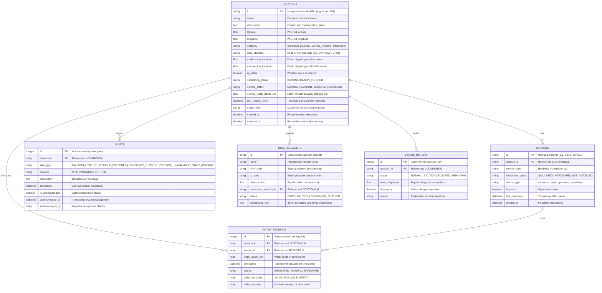

# WAVEGUARD: DATABASE SCHEMA & ENTITY RELATIONSHIP SPECIFICATION

## 1. Overview

WaveGuard uses **SQLite** through **SQLAlchemy ORM** to provide zero-configuration, reliable, file-based relational data persistence. The schema is normalized into 6 primary entities designed to track underpasses, physical/simulated sensors, historical water depth readings, transport road network segments, alert incidents, and status audit logs.

Database File: `waveguard.db` (Stored in root project directory)

---

## 2. Entity-Relationship Diagram (ERD)

---

## 3. Detailed Table Specifications

### Table 1: `locations`
| Column Name | Type | Constraints | Description |
|---|---|---|---|
| `id` | VARCHAR(64) | PRIMARY KEY, INDEX | Unique location identifier (e.g. `blr-loc-001`) |
| `name` | VARCHAR(255) | NOT NULL, INDEX | Human-readable name (e.g. `Marathahalli Underpass`) |
| `description` | TEXT | NULLABLE | Geographic and hydraulic context |
| `latitude` | FLOAT | NOT NULL | WGS 84 Latitude (Bengaluru bounds ~12.8° to 13.2°) |
| `longitude` | FLOAT | NOT NULL | WGS 84 Longitude (Bengaluru bounds ~77.4° to 77.8°) |
| `category` | VARCHAR(64) | NOT NULL, DEFAULT 'underpass' | Category: `underpass`, `subway`, `arterial_lowpoint` |
| `road_identifier` | VARCHAR(128) | NULLABLE | Roadway corridor code (e.g. `ORR-EAST-UP01`) |
| `caution_threshold_cm` | FLOAT | NOT NULL, DEFAULT 15.0 | Water depth threshold triggering `CAUTION` status |
| `closure_threshold_cm` | FLOAT | NOT NULL, DEFAULT 35.0 | Water depth threshold triggering `BLOCKED` status |
| `is_active` | BOOLEAN | NOT NULL, DEFAULT TRUE | Soft-delete / monitoring toggle |
| `verification_status` | VARCHAR(64) | DEFAULT 'DEMONSTRATION_VERIFIED' | Dataset verification label |
| `current_status` | VARCHAR(32) | NOT NULL, DEFAULT 'UNKNOWN' | Real-time classified status: `NORMAL`, `CAUTION`, `BLOCKED`, `UNKNOWN` |
| `current_water_depth_cm` | FLOAT | NOT NULL, DEFAULT 0.0 | Latest water depth in centimetres |
| `last_reading_time` | DATETIME | NULLABLE | Timestamp of last received reading |
| `source_info` | VARCHAR(255) | DEFAULT 'OpenStreetMap & BBMP Flood Survey' | Geographic data provenance |
| `created_at` | DATETIME | DEFAULT UTC NOW | Record creation timestamp |
| `updated_at` | DATETIME | ON UPDATE UTC NOW | Record update timestamp |

---

### Table 2: `sensors`
| Column Name | Type | Constraints | Description |
|---|---|---|---|
| `id` | VARCHAR(64) | PRIMARY KEY, INDEX | Unique sensor identifier |
| `location_id` | VARCHAR(64) | FOREIGN KEY (`locations.id`) | Monitored location reference |
| `sensor_code` | VARCHAR(64) | UNIQUE, NOT NULL | Device serial or simulated hardware identifier |
| `installation_status` | VARCHAR(32) | NOT NULL, DEFAULT 'SIMULATED' | Status: `SIMULATED`, `HARDWARE`, `NOT_INSTALLED` |
| `sensor_type` | VARCHAR(64) | NOT NULL, DEFAULT 'ultrasonic_depth' | Sensor technology |
| `is_active` | BOOLEAN | NOT NULL, DEFAULT TRUE | Operational state |
| `last_heartbeat` | DATETIME | NULLABLE | Timestamp of last device heartbeat |
| `created_at` | DATETIME | DEFAULT UTC NOW | Registration timestamp |

---

### Table 3: `water_readings`
| Column Name | Type | Constraints | Description |
|---|---|---|---|
| `id` | INTEGER | PRIMARY KEY, AUTOINCREMENT | Unique reading identifier |
| `location_id` | VARCHAR(64) | FOREIGN KEY (`locations.id`), INDEX | Monitored location reference |
| `sensor_id` | VARCHAR(64) | FOREIGN KEY (`sensors.id`), NULLABLE | Sensor emitting measurement |
| `water_depth_cm` | FLOAT | NOT NULL | Water depth in centimetres |
| `timestamp` | DATETIME | NOT NULL, INDEX | Ingestion timestamp |
| `source` | VARCHAR(32) | DEFAULT 'SIMULATED' | Measurement source: `SIMULATED`, `MANUAL`, `HARDWARE` |
| `validation_status` | VARCHAR(32) | DEFAULT 'VALID' | Status: `VALID`, `INVALID`, `SUSPECT` |
| `validation_note` | VARCHAR(255) | NULLABLE | Explanation if measurement was rejected |

---

### Table 4: `road_segments`
| Column Name | Type | Constraints | Description |
|---|---|---|---|
| `id` | VARCHAR(64) | PRIMARY KEY, INDEX | Network edge identifier |
| `name` | VARCHAR(255) | NOT NULL | Road name (e.g. `Old Airport Road Corridor`) |
| `from_node` | VARCHAR(64) | NOT NULL, INDEX | Topological start junction |
| `to_node` | VARCHAR(64) | NOT NULL, INDEX | Topological end junction |
| `distance_km` | FLOAT | NOT NULL | Physical corridor length |
| `associated_location_id` | VARCHAR(64) | FOREIGN KEY (`locations.id`), NULLABLE | Underpass directly impacting this road edge |
| `status` | VARCHAR(32) | DEFAULT 'OPEN' | Road status: `OPEN`, `CAUTION`, `CONFIRMED_BLOCKED` |
| `coordinates_json` | TEXT | NULLABLE | GeoJSON LineString geometry array |

---

### Table 5: `alerts`
| Column Name | Type | Constraints | Description |
|---|---|---|---|
| `id` | INTEGER | PRIMARY KEY, AUTOINCREMENT | Unique alert identifier |
| `location_id` | VARCHAR(64) | FOREIGN KEY (`locations.id`), INDEX | Impacted location reference |
| `alert_type` | VARCHAR(64) | NOT NULL | Category: `CAUTION_LEVEL`, `CONFIRMED_CLOSURE`, `STALE_READING` |
| `severity` | VARCHAR(32) | NOT NULL | Severity level: `INFO`, `WARNING`, `CRITICAL` |
| `description` | TEXT | NOT NULL | Plain-language alert message |
| `timestamp` | DATETIME | NOT NULL, INDEX | Alert trigger timestamp |
| `is_acknowledged` | BOOLEAN | DEFAULT FALSE | Acknowledgement state |
| `acknowledged_at` | DATETIME | NULLABLE | Timestamp of acknowledgement |
| `acknowledged_by` | VARCHAR(64) | NULLABLE | Operator name |

---

### Table 6: `status_history`
| Column Name | Type | Constraints | Description |
|---|---|---|---|
| `id` | INTEGER | PRIMARY KEY, AUTOINCREMENT | Audit record ID |
| `location_id` | VARCHAR(64) | FOREIGN KEY (`locations.id`), INDEX | Location reference |
| `status` | VARCHAR(32) | NOT NULL | Status changed to: `NORMAL`, `CAUTION`, `BLOCKED`, `UNKNOWN` |
| `water_depth_cm` | FLOAT | NOT NULL | Water level at time of state change |
| `timestamp` | DATETIME | NOT NULL, INDEX | Timestamp of transition |
| `reason` | VARCHAR(255) | NULLABLE | Cause or threshold trigger reason |
