# WAVEGUARD: SYSTEM ARCHITECTURE SPECIFICATION

## 3D Urban Waterlogging Monitoring & Safe Route Guidance System
**Geographical Focus:** Bengaluru, Karnataka, India  
**Target Domain:** Smart City / Urban Infrastructure / GIS / IoT Telemetry  
**System Architecture:** Zero-Cost Modular Monolith with Decoupled Frontend, Backend, Geospatial Routing & Simulated Telemetry

---

## 1. Architectural Philosophy & Core Objectives

WaveGuard is designed as an open-source, resilient, zero-paid-API smart city digital twin specifically built to address urban monsoon flash-flooding and underpass waterlogging in **Bengaluru, Karnataka, India**.

### Core Engineering Tenets
1. **Zero-Paid External API Dependencies:** Uses public vector tile endpoints (OpenFreeMap / OpenStreetMap) and local graph algorithms without requiring paid Google Maps, Mapbox, or routing API subscriptions.
2. **Deterministic Topological Routing:** Implements Dijkstra shortest-path calculations using NetworkX over an authentic topological road corridor network, actively detouring around `CONFIRMED_BLOCKED` underpasses.
3. **Location-Specific Inundation Thresholds:** Every underpass maintains custom `caution_threshold_cm` (e.g., 15 cm) and `closure_threshold_cm` (e.g., 35 cm) based on local vehicle clearance and road geometry.
4. **Data Staleness & Fail-Safe Logic:** Readings older than the configured freshness window (default: 30 minutes) degrade safely to `UNKNOWN` to prevent commuters from assuming an unmonitored road is clear.
5. **Separation of Concerns:** Clear demarcation between data storage (SQLite), ingestion/validation/classification services (FastAPI), simulated telemetry pipeline, routing graph solver, and frontend visualization (React 19 + MapLibre GL JS).

---

## 2. High-Level System Architecture Diagram

```mermaid
flowchart TD
    subgraph Client ["Frontend User Interface (React 19 + TypeScript + Vite)"]
        UI1["1. Overview Dashboard"]
        UI2["2. 3D Bengaluru Map Digital Twin"]
        UI3["3. Location & Underpass Registry"]
        UI4["4. Water Telemetry & Simulator Control"]
        UI5["5. Alerts & Incident Notification Center"]
        UI6["6. Dijkstra Safe Route Guidance"]
        UI7["7. Grounded AI Copilot (Groq / Rule Fallback)"]
        UI8["8. System Settings & Governance"]
        MAP["MapLibre GL JS (3D Extrusion + Water Rings)"]
    end

    subgraph Backend ["FastAPI Geospatial Analytical Backend (:8000)"]
        API["FastAPI REST Endpoints (/api)"]
        CLS["Waterlogging Classification Engine"]
        ALT["Alert Deduplication & Management Service"]
        SIM["Telemetry Simulation & Scenario Injector"]
        ROUTER["Geospatial Detour Routing Engine (NetworkX)"]
        AI["Data-Grounded AI Copilot Service (Groq API)"]
    end

    subgraph Data ["Data & Graph Persistence Layer"]
        DB[("Persistent SQLite Database<br/>(waveguard.db)")]
        GRAPH["Demonstration Road Graph<br/>(bengaluru_corridors.json)"]
        GEO["Sample Locations GeoJSON<br/>(sample_locations.geojson)"]
    end

    subgraph Future ["Future Physical IoT Hardware"]
        ESP["ESP32 Microcontrollers"]
        US["JSN-SR04T Waterproof Ultrasonic Sensors"]
        LTE["4G NB-IoT / LoRaWAN Gateways"]
    end

    SIM -.->|Simulated Ultrasonic Pulse| API
    ESP -.->|Future Field Telemetry| API
    API --> CLS
    CLS --> DB
    CLS --> ALT
    ALT --> DB
    ROUTER --> DB
    ROUTER --> GRAPH
    AI --> DB
    UI1 & UI2 & UI3 & UI4 & UI5 & UI6 & UI7 & UI8 <-->|JSON REST HTTP| API
    MAP <-->|Vector Tiles| OFM["OpenFreeMap Vector Tile Service"]
```



---

## 3. Subsystem Breakdown

### 3.1. Frontend Web Application
- **Framework:** React 19 with TypeScript, bundled using Vite.
- **Styling:** Tailwind CSS adhering to the strict urban infrastructure design system:
  - Clean white canvas (`bg-white` / `bg-slate-50`).
  - Deep Navy Blue primary navigation header (`bg-slate-900`).
  - Cyan (`#0284c7`) and Light-Blue accents.
  - Light-grey panels (`bg-white border-slate-200`) with high-contrast, professional typography.
- **3D Geospatial Engine:** MapLibre GL JS 5.1 vector tile client rendering:
  - 3D building extrusions interpolated from zoom 13 to 15.
  - Interactive marker pins with status-colored indicators:
    - **GREEN:** Normal clearance (`< caution_threshold_cm`).
    - **AMBER:** Caution inundation (`>= caution_threshold_cm` and `< closure_threshold_cm`).
    - **RED:** Confirmed Blocked (`>= closure_threshold_cm`).
    - **GREY:** Stale / Unknown telemetry.
  - Dynamic route line overlays and dashed red avoided hazard segments.
- **State Management:** Centralized `AppContext` with periodic background polling (6 seconds) to synchronize live simulation pulses across all 8 navigation views.

### 3.2. Backend API Service
- **Framework:** FastAPI with Python 3.11/3.14.
- **Validation:** Pydantic v2 schemas enforcing strict typing, coordinate bounds, and measurement validity.
- **Structured Logging:** Standardized Python logging with timestamp, severity, and module provenance.
- **CORS Middleware:** Local origins (`localhost:5173`, `127.0.0.1:5173`) whitelisted for secure cross-origin communication.

### 3.3. Database Persistence Layer
- **Engine:** Persistent SQLite database (`waveguard.db`) via SQLAlchemy ORM.
- **Tables:** `locations`, `sensors`, `water_readings`, `road_segments`, `alerts`, `status_history`.
- **Integrity:** Foreign keys, primary keys, indexing on `location_id`, `timestamp`, and `status`.

### 3.4. Waterlogging Classification Engine
- **Decoupled Business Logic:** Implemented in `app/services/classification.py`.
- **Validation Phase:** Rejects negative water depths and physically impossible readings (> 500 cm).
- **Staleness Phase:** Compares timestamp against `FRESHNESS_WINDOW_MINUTES`. If elapsed time exceeds window, status becomes `UNKNOWN`.
- **Threshold Phase:** Compares valid, fresh measurement against location-specific `caution_threshold_cm` and `closure_threshold_cm`.

### 3.5. Topological Routing Engine
- **Solver:** NetworkX Dijkstra algorithm executing on a directed/undirected graph of major Bengaluru transport corridors.
- **Hazard Avoidance:** When an underpass is in `BLOCKED` status, the corresponding road edge is removed from graph traversal (or assigned infinite impedance).
- **Safe Alternative Selection:** Calculates the shortest viable detour around the blocked area and returns GeoJSON coordinates, distance, and a human-readable explanation.

### 3.6. Grounded AI Copilot
- **Provider:** Groq API using high-speed large language models (e.g. `openai/gpt-oss-120b`).
- **Grounding Protocol:** Injects real-time database state (active blocked locations, caution areas, alert counts) into the system prompt.
- **Zero Hallucination Constraint:** Explicit system prompt instructions forbid fabricating depths, coordinates, or safety guarantees.
- **Resilient Fallback:** If the Groq API key is missing or encounters HTTP 429 / network errors, the engine automatically engages an intelligent local rule-based response engine.

### 3.7. Simulated Telemetry Pipeline
- **Asynchronous Task:** Async loop running in FastAPI backend background.
- **Configurable Pulse Rate:** Default 5 seconds per tick.
- **Scenarios:** `DRY_WEATHER`, `LIGHT_SHOWERS`, `MONSOON_SURGE`, `FLASH_FLOOD`, `RECEDING`.
- **Manual Injection:** Admin operator can inject arbitrary depth readings to test real-time threshold transitions.

---

## 4. Hardware Integration Roadmap (Future Field Deployment)

While the college prototype operates on simulated telemetry, the system is architected for seamless transition to physical IoT hardware:

```
[ Ultrasonic Transducer (JSN-SR04T) ]
                │ (Echo/Trigger pulse)
                ▼
[ ESP32-WROOM Microcontroller ] ── (Wi-Fi / 4G NB-IoT HTTP POST) ──► [ WaveGuard /api/readings ]
                ▲
                │ (Power Management)
[ Solar Panel (10W) + LiFePO4 Battery ]
```

1. **Sensor Node:** Weatherproof ultrasonic transducer installed on the underpass soffit measuring distance to the road surface. Water depth is calculated as:
   $$\text{Water Depth (cm)} = \text{Sensor Height Above Ground (cm)} - \text{Measured Distance (cm)}$$
2. **Telemetry Ingestion:** ESP32 posts JSON payloads directly to `POST /api/readings` with `source: "HARDWARE"`.
3. **Zero Frontend/Backend Changes:** The classification engine, alert pipeline, and routing engine automatically process live measurements identically to simulated ones.
