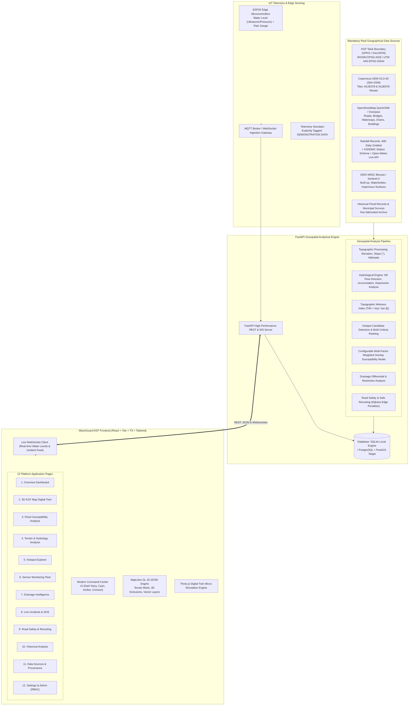

# WAVEGUARD KGF: System Architecture & Technical Specifications
**3D Urban Flood Intelligence and Situational Awareness Platform**
*Target Study Area: Kolar Gold Fields (KGF) Taluk, Karnataka, India*

---

## 1. System Architecture Overview

---

## 2. Database Schema (PostGIS & SQLite Compatible)

### Relational Tables Definition

1. **`taluk_boundaries`**
   - `id`: INTEGER PRIMARY KEY AUTOINCREMENT
   - `name`: VARCHAR(100) -- 'Kolar Gold Field'
   - `boundary_type`: VARCHAR(50) -- 'administrative', 'urban_builtup', 'catchment', 'analysis_buffer'
   - `crs`: VARCHAR(50) -- 'EPSG:4326', 'EPSG:32644'
   - `geometry_geojson`: TEXT (GeoJSON MultiPolygon / Polygon)
   - `bbox_west`, `bbox_south`, `bbox_east`, `bbox_north`: REAL
   - `area_sqkm`: REAL
   - `source`: VARCHAR(255)
   - `created_at`: TIMESTAMP

2. **`dem_products`**
   - `id`: INTEGER PRIMARY KEY AUTOINCREMENT
   - `layer_type`: VARCHAR(50) -- 'elevation', 'slope', 'hillshade', 'flow_accumulation', 'twi', 'depressions'
   - `file_path`: VARCHAR(255)
   - `grid_width`: INTEGER
   - `grid_height`: INTEGER
   - `cell_size_m`: REAL
   - `min_value`: REAL
   - `max_value`: REAL
   - `mean_value`: REAL
   - `unit`: VARCHAR(30) -- 'meters', 'degrees', 'pixels', 'index'
   - `crs`: VARCHAR(50)
   - `metadata_json`: TEXT
   - `created_at`: TIMESTAMP

3. **`hotspots`**
   - `id`: INTEGER PRIMARY KEY AUTOINCREMENT
   - `hotspot_code`: VARCHAR(50) UNIQUE -- e.g. 'KGF-HOT-001'
   - `name`: VARCHAR(150)
   - `latitude`: REAL
   - `longitude`: REAL
   - `elevation_m`: REAL
   - `slope_deg`: REAL
   - `flow_accum_pixels`: REAL
   - `catchment_area_ha`: REAL
   - `nearby_drainage_type`: VARCHAR(100)
   - `historical_evidence`: TEXT
   - `verification_status`: VARCHAR(50) -- 'unverified', 'field_surveyed', 'confirmed_hotspot', 'rejected'
   - `inspection_priority`: VARCHAR(30) -- 'critical', 'high', 'medium', 'low'
   - `susceptibility_score`: REAL (0.0 to 1.0)
   - `confidence_score`: REAL (0.0 to 1.0)
   - `recommended_action`: TEXT
   - `created_at`: TIMESTAMP
   - `updated_at`: TIMESTAMP

4. **`iot_stations`**
   - `id`: INTEGER PRIMARY KEY AUTOINCREMENT
   - `station_code`: VARCHAR(50) UNIQUE -- e.g. 'KGF-SEN-01'
   - `name`: VARCHAR(150)
   - `latitude`: REAL
   - `longitude`: REAL
   - `channel_name`: VARCHAR(100)
   - `installation_type`: VARCHAR(50) -- 'nallah_bridge', 'culvert', 'underpass', 'storm_channel'
   - `is_simulated`: BOOLEAN DEFAULT 1
   - `provenance_label`: VARCHAR(100) -- 'DEMONSTRATION DATA' or 'FIELD_TELEMETRY'
   - `warning_threshold_m`: REAL
   - `critical_threshold_m`: REAL
   - `max_channel_depth_m`: REAL
   - `status`: VARCHAR(30) -- 'online', 'warning', 'critical', 'offline', 'maintenance'
   - `battery_pct`: REAL
   - `last_seen`: TIMESTAMP

5. **`sensor_telemetry`**
   - `id`: INTEGER PRIMARY KEY AUTOINCREMENT
   - `station_id`: INTEGER REFERENCES iot_stations(id)
   - `timestamp`: TIMESTAMP
   - `water_level_m`: REAL
   - `rate_of_rise_m_hr`: REAL
   - `rainfall_last_hr_mm`: REAL
   - `battery_voltage`: REAL
   - `rssi_dbm`: INTEGER
   - `is_simulated`: BOOLEAN
   - `raw_payload`: TEXT

6. **`drainage_monitoring`**
   - `id`: INTEGER PRIMARY KEY AUTOINCREMENT
   - `upstream_station_id`: INTEGER REFERENCES iot_stations(id)
   - `downstream_station_id`: INTEGER REFERENCES iot_stations(id)
   - `reach_name`: VARCHAR(150)
   - `status`: VARCHAR(50) -- 'normal', 'rising_water', 'possible_restriction', 'possible_overflow', 'sensor_fault', 'insufficient_information'
   - `differential_head_m`: REAL
   - `diagnosis_notes`: TEXT
   - `evaluated_at`: TIMESTAMP

7. **`incidents`**
   - `id`: INTEGER PRIMARY KEY AUTOINCREMENT
   - `incident_number`: VARCHAR(50) UNIQUE
   - `category`: VARCHAR(50) -- 'waterlogging', 'blocked_drain', 'road_impassable', 'infrastructure_damage', 'emergency_sos'
   - `title`: VARCHAR(200)
   - `description`: TEXT
   - `latitude`: REAL
   - `longitude`: REAL
   - `reporter_type`: VARCHAR(50) -- 'citizen', 'field_engineer', 'sensor_automated'
   - `reporter_contact`: VARCHAR(100)
   - `verification_status`: VARCHAR(50) -- 'unverified', 'investigating', 'verified', 'resolved', 'false_alarm'
   - `severity`: VARCHAR(30) -- 'low', 'medium', 'high', 'critical'
   - `photo_url`: VARCHAR(255)
   - `reported_at`: TIMESTAMP
   - `verified_at`: TIMESTAMP
   - `assigned_team`: VARCHAR(100)

8. **`road_segments`**
   - `id`: INTEGER PRIMARY KEY AUTOINCREMENT
   - `osm_id`: VARCHAR(50)
   - `name`: VARCHAR(150)
   - `highway_type`: VARCHAR(50)
   - `surface`: VARCHAR(50)
   - `length_m`: REAL
   - `status`: VARCHAR(50) -- 'open', 'caution', 'waterlogged', 'closed'
   - `closure_reason`: TEXT
   - `water_depth_cm`: REAL
   - `geometry_geojson`: TEXT
   - `updated_at`: TIMESTAMP

9. **`historical_floods`**
   - `id`: INTEGER PRIMARY KEY AUTOINCREMENT
   - `event_date`: DATE
   - `location_name`: VARCHAR(150)
   - `latitude`: REAL
   - `longitude`: REAL
   - `reported_depth_m`: REAL
   - `duration_hours`: REAL
   - `rainfall_24h_mm`: REAL
   - `data_source`: VARCHAR(255)
   - `verified`: BOOLEAN
   - `remarks`: TEXT

10. **`data_sources_registry`**
    - `id`: INTEGER PRIMARY KEY AUTOINCREMENT
    - `dataset_code`: VARCHAR(50) UNIQUE
    - `title`: VARCHAR(200)
    - `provider`: VARCHAR(200)
    - `url`: VARCHAR(255)
    - `download_date`: DATE
    - `spatial_resolution`: VARCHAR(100)
    - `crs`: VARCHAR(50)
    - `temporal_coverage`: VARCHAR(100)
    - `limitations`: TEXT
    - `processing_history`: TEXT
    - `status`: VARCHAR(50)

---

## 3. Dataset Ingestion Plan

| Dataset | Provider / Source | Tile / Feature Range | Spatial Extent | Processing Pipeline | Target Layer |
|---|---|---|---|---|---|
| **Administrative Boundary** | Karnataka GIS / Taluk.zip | Taluk Code: 1912 / 7002 ("Kolar Gold Field") | 78.227°E - 78.475°E, 12.858°N - 13.083°N | Reproject to EPSG:32644 & WGS84 EPSG:4326 | `data/boundaries/KGF_Taluk_Boundary_WGS84.geojson` |
| **Copernicus DEM GLO-30** | AWS Open Data Copernicus S3 | `N12_00_E078_00` & `N13_00_E078_00` | 78°E - 79°E, 12°N - 14°N | Download, Mosaic, Reproject to UTM 44N, Clip to Taluk + Buffer | `data/dem/kgf_dem_glo30_utm.tif` |
| **OpenStreetMap Infrastructure** | Overpass API / Geofabrik Karnataka | KGF Bounding Box | 78.22°E - 78.48°E, 12.85°N - 13.09°N | Ingest highways, waterways, natural water, buildings, culverts | `data/roads/`, `data/drainage/` |
| **Rainfall History & Live** | IMD / KSNDMC / Open-Meteo Live API | KGF station coordinates (12.96°N, 78.27°E) | Point & Gridded | Daily historical archive + live hourly forecast & telemetry sync | `data/rainfall/` |
| **LULC / Impervious Surfaces** | NRSC Bhuvan / Sentinel-2 RGB/NIR | KGF urban & rural zone | 78.22°E - 78.48°E | Classification into Built-up, Vegetation, Water, Barren | `data/landcover/` |
| **Historical Inundations** | Municipal records, KSNDMC reports | Verified past waterlogging occurrences | KGF localities | Ingestion with rigorous source attribution | `data/historical_floods/` |

---

## 4. Development Milestones & Phased Execution

### Phase 1: Foundation & Core GIS Infrastructure (Current)
- Complete directory organization matching specification.
- Ingest and validate official KGF boundary GeoJSON & GPKG.
- Implement DEM mosaic, clipping, and elevation analysis engine.
- Establish FastAPI backend and SQLite spatial relational database.
- Create MapLibre GL JS 2D/3D interactive viewer with layer toggling.
- Implement Data Sources & Provenance Registry.

### Phase 2: Scientific Terrain & Hydrology Processing Pipeline
- Slope gradient calculation (in degrees).
- Hillshade multi-directional illumination rendering.
- D8 flow direction and downslope steepest descent matrix.
- Flow accumulation (upslope catchment pixel counting & runoff pathways).
- Terrain depression identification (depth, surface area, fill volume).
- Topographic Wetness Index (TWI) calculation with documented limitations.

### Phase 3: Flood Susceptibility Model & Hotspot Ranking
- Configurable multi-criteria evaluation (MCE) weighted overlay engine.
- Normalization curves for slope, elevation, accumulation, TWI, and land cover.
- Interactive weight adjustment UI with real-time recalculation.
- Hotspot candidate ranking algorithm integrating terrain, infrastructure, and field survey status.
- Export capabilities (GeoJSON, GeoTIFF, CSV report).

### Phase 4: IoT Telemetry & Drainage Intelligence
- Station fleet management (water level, rainfall, battery, signal).
- Strict separation of live field telemetry vs explicit "DEMONSTRATION DATA".
- Real-time WebSocket streaming and threshold alarm triggers.
- Upstream vs downstream differential hydraulic monitoring for blockage suspicion.

### Phase 5: Public Situational Awareness & Authority Command Center
- Citizen flood reporting interface with GPS geolocation and photo attachment.
- Verified emergency alerts and safety advisories.
- Dynamic road closure mapping and safe rerouting algorithm (Dijkstra detour).
- Authority Command Center dashboard with RBAC (Role-Based Access Control).
- Complete 12-page responsive UI.
